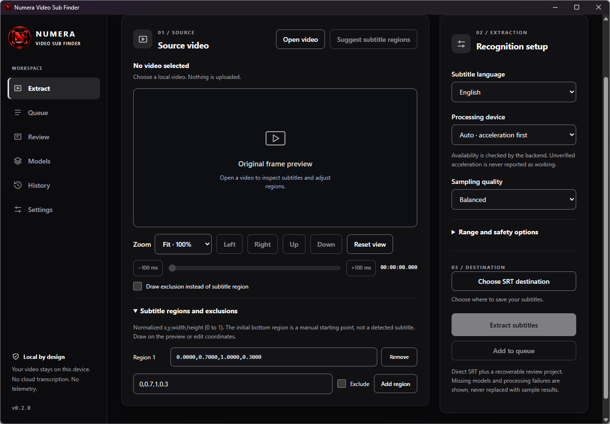

<div align="center">


# Numera Video Sub Finder

[](https://github.com/KiaroSama/Numera-Video-Sub-Finder/actions/workflows/verify.yml)
[](LICENSE)
[](https://github.com/KiaroSama/Numera-Video-Sub-Finder/tags)
[](#releases-and-tags)
[](rust-toolchain.toml)
[](ci/targets.json)
[](docs/architecture.md)
[](docs/installation.md)
[](Cargo.toml)
[](crates/desktop/Cargo.toml)
[](crates/ui/Cargo.toml)
[](vcpkg.json)
[](ci/native-lock.json)
[](ci/tessdata.json)
[](#donate)

</div>

An offline-first desktop workspace for extracting visible, burned-in subtitles from video, reviewing their source frames, and exporting timed Unicode subtitles. Application code, including the Leptos/WebAssembly frontend and CLI, is written in Rust. Tauri and native FFmpeg, ONNX Runtime and Tesseract provide platform integrations.

<p align="center">
  
</p>

## Status

The live CI badge shows the status of hosted checks. See [validation status](docs/validation.md) for verification coverage and remaining external gates. Android and iPhone applications are not included.

The four native 64-bit targets are Windows x64, Windows ARM64, Linux x64 and Linux ARM64. All 32-bit builds are excluded. Hosted CPU CI is separate from real-device accelerator qualification. Windows binaries and MSI installers are signed with the project owner's self-signed Authenticode certificate (`D-014`, thumbprint `B2A45C4E8257197BBF067ED94F83E626AC6CE1C5`); no public CA certificate is used. Verify downloaded packages against the published `SHA256SUMS.txt`. If you installed `0.4.0` or earlier using NSIS, uninstall it before switching to an MSI package.

## Releases and Tags

The 0.x series increments the minor version. The badges above update from [GitHub Tags](https://github.com/KiaroSama/Numera-Video-Sub-Finder/tags) and [GitHub Releases](https://github.com/KiaroSama/Numera-Video-Sub-Finder/releases) as tags and releases are published.

### What's new in v0.7.0

- A persistent FFmpeg preview process keeps the source open during playback, so the app no longer starts a process for each frame.
- Graphite Studio v2 rounds panels and controls, keeps the timeline playhead separate from the extraction range, and respects reduced-motion settings for its transitions.
- Resize the viewport from all four sides. Press the backtick key for Focus Mode, or `Z` to use Photoshop-style marquee zoom. Drag a box around part of the frame, then use `Ctrl+0` to reset the view.
- Save a `.nvsf` project as soon as a video is loaded. The app asks what to do with unsaved changes when you close it.
- The bell on the right keeps notifications out of the workspace layout. **Additional language packs** lists installed packs when the page opens.
- The [agent plugins](docs/installation.md#agent-plugins) cover Claude Code, Codex, Cursor, Antigravity and Agent Plugins 1.0 hosts. They use the local CLI without an MCP server.

GitHub Actions signs Windows binaries and updater artifacts only in the protected `numera-signing` deployment environment. The release workflow publishes artifacts from the exact verified commit.

## Installation and setup

Download the matching 64-bit package for your OS and architecture from [GitHub Releases](https://github.com/KiaroSama/Numera-Video-Sub-Finder/releases) and follow the [installation guide](docs/installation.md) to verify checksums, install required models, and run a first extraction. Windows packages carry the owner's self-signed Authenticode signature (`D-014`), so Windows SmartScreen may prompt before first launch.

## Workflow

The Graphite Studio desktop workspace has a menu bar in the top left: **File**, **Edit**, **View**, **Tools**, and **Help**.

1. Load media either through the native **Open video** dialog (`Ctrl+O`) or by dragging and dropping onto the window:
   - Drop a **single video file** (`.mp4`, `.mkv`, `.mov`, `.avi`, `.webm`, `.m4v`, `.ts`, `.mts`, `.m2ts`, `.mpeg`, `.wmv`) to open it directly in **Extract**, where the preview automatically seeks past a black opening frame when present, then pick an `.srt` destination.
   - Drop **multiple video files or a folder** (scanned up to 4 levels deep, up to 100 videos; symlinks and unsupported files are skipped) to queue them automatically in **Queue** with sibling `.srt` outputs.
2. Frame the subtitle band directly on the resizable preview canvas: drag to draw a new subtitle or exclusion region with a live preview box, drag any of the 8 corner/edge handles or 4 separating guide lines to resize it, or move the box directly. Use **Play/Pause** (`Space`), **Stop**, frame stepping (`Left`/`Right`, `Shift+Left`/`Shift+Right`), **Set start** (`I`), and **Set end** (`O`) to inspect timing before extraction.
3. Pick the subtitle language using the searchable **Subtitle language** box: type any part of the English name, native name (`فارسی`, `日本語`), or language code (`fa`, `ja`, `chi_sim`, `fra`) to filter all 126 languages live, press `Enter` or click a match, then set quality and device policy. Compatible admitted Paddle recognizers are used where available; other languages require their selected Tesseract pack. English, Persian and Japanese keep their original qualification targets; catalog availability does not certify accuracy. Automatic region detection gives editable suggestions; scene signs are not accepted as dialogue on their own.
4. Start extraction (`Ctrl+Enter`). Pause and cancel controls keep compatible checkpoints; missing models return an actionable error instead of downloading during inference.
5. Review original frames, edit text and times, split or merge cues, undo or redo changes (`Ctrl+Z` / `Ctrl+Y` in both **Extract** and **Review**), and explicitly accept re-recognition proposals.
6. Use **Save** (`Ctrl+S`) or **Save As** (`Ctrl+Shift+S`) to store a `.nvsf` project before or after extraction. Export reviewed cues to SRT, WebVTT, basic ASS or JSON. Closing with unsaved edits prompts you to save and exit, exit without saving, or cancel. Press `F1` to view keyboard shortcuts.

Monochrome Dark and Light themes run locally: Dark is the initial default, and your explicit theme choice is saved. The single-click toggle plays a native Rust/WASM WebGL1 brushed-silver sweep (`glimm`) and honors `prefers-reduced-motion`. There are no remote fonts, cloud transcription or authored JavaScript application components. Generated Tauri/WASM glue is required by the frameworks.

## CLI

The package includes `nvsf` (`nvsf.exe` on Windows), also used as the isolated GUI worker. Keep it beside the GUI and `runtimes` directory.

```bash
nvsf --help
```

Provision models explicitly while online, or import a known-hash model file from an offline source:

```bash
nvsf models install
```

```bash
nvsf extract --input "video with subtitles.mp4" --output "subtitles.srt" --language fa --quality accurate --device cpu
```

```bash
nvsf probe "video with subtitles.mp4"
```

```bash
nvsf doctor
```

List additional language codes, then install only the language you need:

```bash
nvsf languages list
```

```bash
nvsf languages install fra
```

```bash
nvsf dependencies
```

`dependencies --repair --consent` requests a matching signed application-local native pack when a component is missing or incompatible; it never installs system FFmpeg or changes PATH. A matching published pack is required. Restart after repair. `doctor` reports actual native API and version checks, not proven operator placement. `--gpu-required` and `--accelerator-required` fail when the requested execution policy cannot be established; only ONNX Runtime's forced CPU shape operators may run on CPU. `auto` may use CPU only with a reported fallback; an ordinary CPU package does not contain CUDA or DirectML runtime qualification. Device options are `cpu`, `auto`, `cuda` and `directml`.

`batch`, `bulk`, `resume`, `export`, `benchmark`, `project`, `regions`, `preview`, `queue`, `updates`, and `preferences` share the native application service and emit structured JSON for non-interactive automation and AI agents. Run concurrent multi-video extraction with `bulk` (or `batch --concurrency`):

```bash
nvsf preview strip --input "video.mp4" --output-dir "./frames" --count 6 --grid --overwrite
nvsf preview frame --input "video.mp4" --at-ms 12000 --output "check.png" --grid --draw-box 0.05,0.75,0.9,0.2 --overwrite
nvsf bulk --input-dir "./videos" --output-dir "./subtitles" --language en --concurrency 2
```

The [agent skill](skills/numera-video-sub-finder/SKILL.md) and its [CLI reference](skills/numera-video-sub-finder/references/cli-reference.md) cover flags, JSON output and exit codes. In Claude Code, install it with:

```text
/plugin install numera-video-sub-finder --marketplace KiaroSama/Numera-Video-Sub-Finder
```

See [agent plugin installation](docs/installation.md#agent-plugins) for the other hosts. Run a subcommand with `--help` for its exact options. Benchmark elapsed time measures the current run only.

## Data and privacy

Writable models, projects, logs and cache use the OS's local application-data directory under `Numera Video Sub Finder`. Set `NVSF_DATA_ROOT` before launching either program to select a shared location. The CLI-only `--data-root` flag overrides that variable. With neither set, `portable.flag` next to the executable selects its sibling `data` directory. `NVSF_RUNTIME_ROOT` overrides native runtime discovery; ordinary packages load their bundled runtimes.

Video and subtitle text stay local during inference. The desktop checks signed official stable-release metadata at startup and at most daily while open; disable automatic checks in Settings or check manually. No update payload downloads or installs without separate approval. Explicit model or language provisioning and approved dependency repair also use the network. Model bytes are checked against pinned hashes; managed runtime packs and update metadata require signatures. No stable release or feed is claimed before publication.

Installed Windows packages and Linux AppImage are the intended automatic-update formats; portable archives, deb and rpm use verified download and manual format-specific installation. Save review edits and finish jobs or resource operations before installation. Checkpoints bind source, configuration and selected resources; installing unrelated language packs does not alter their identity. Private media, crop evidence, projects and logs are never uploaded by the application.

## Logging

Each CLI, worker or desktop run creates a new UTF-8 file in the selected data root's `logs` directory, named `<script-name>_YYYY-MM-DD_HH-mm-ss_UTC.log` (with a collision suffix when needed). Entries use `[YYYY-MM-DD HH:mm:ss UTC] [LEVEL] [COMPONENT] Message`. Levels are DEBUG, INFO, WARNING, ERROR and CRITICAL. Diagnostic startup, resource, job and exit events are recorded without OCR text, credentials or request bodies; logging initialization failure falls back to stderr. Handles are flushed and closed.

Logs and original crop evidence stay local. At startup, matching application logs older than 30 days or beyond 100 historical files are pruned; logs modified within 24 hours stay on disk to protect concurrent runs. Retention failures are logged as warnings. Crop evidence is not removed by log retention. Review and redact paths or private context before attaching a log to a support issue. No verbose mode is promised where the CLI does not expose one.

## Builds and tests

Builds run only in GitHub Actions. Manually dispatch Final verification (`verify.yml`) after all changes are pushed; it calls native, portable-quality, dependency and source-analysis lanes once for that commit and publishes commit statuses for all 14 verification jobs on that SHA. Pushes and pull requests do not start CI automatically. The committed lockfile, native source baseline, model manifests and four-target inventory drive the pipeline. Local Cargo, Trunk or Tauri compilation is not part of the project's authorized workflow.

See [testing](docs/testing.md), [architecture](docs/architecture.md), [OCR contracts](docs/ocr-models.md), [performance policy](docs/performance.md), [platform support](docs/platform-support.md), [CI matrix](docs/ci-matrix.md), [troubleshooting](docs/troubleshooting.md), [references](docs/references.md), and [third-party notices](THIRD_PARTY_NOTICES.md). Generated synthetic fixtures cover integration and timing mechanics only, not held-out real-world CER or subtitle-event recall.

## Author

[KiaroSama](https://github.com/KiaroSama) ([Kiaro.Sama.Dev@gmail.com](mailto:Kiaro.Sama.Dev@gmail.com))

## License

KiaroSama owns the copyright to the application code and licenses it under [GPL-3.0-or-later](LICENSE).

## Donate

If this project helps you, donations are appreciated.

| Currency | Network | Address |
| --- | --- | --- |
| Bitcoin (BTC) | Bitcoin | `bc1qmth5m03pu5hujw5xw5jmywam3jj3sqwqupesdt` |
| USDT, BNB, USDC, etc. | BEP20 | `0x0Bd0BA443a8B9cf15922bf7f0Bb0a4b495fD06Ef` |
| USDT, TRX, USDC, etc. | TRC20 | `TWBA3xFTqgZAeAYMxqo85xWnzvty3DcAhw` |
| Ethereum (ETH) | ERC20 | `0x0Bd0BA443a8B9cf15922bf7f0Bb0a4b495fD06Ef` |
| TON | TON | `UQCN8Umo_OfOWqImZetQsrNStPcmLkMAKajFyiCOhso23NDb` |
| Litecoin (LTC) | LTC | `ltc1qntqnnrunadurnw4cshv3qgspywrueyyeyngwuy` |
| Solana (SOL) | Solana | `7B2wkczUjmkDhETwQuknBL8sUsbuV7nErxc317TmQuwR` |
| Polygon (POL) | Polygon | `0x0Bd0BA443a8B9cf15922bf7f0Bb0a4b495fD06Ef` |
