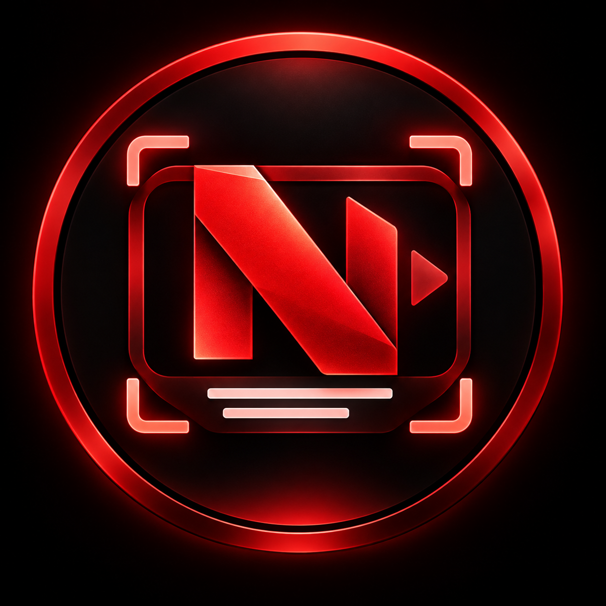

<div align="center">



# Numera Video Sub Finder

[](https://github.com/KiaroSama/Numera-Video-Sub-Finder/actions/workflows/ci.yml)
[](LICENSE)
[](rust-toolchain.toml)
[](Cargo.toml)
[](ci/targets.json)
[](ci/targets.json)
[](ci/targets.json)
[](crates/desktop/Cargo.toml)
[](crates/ui/Cargo.toml)
[](vcpkg.json)
[](ci/native-lock.json)
[](ci/tessdata.json)
[](docs/architecture.md)
[](#donate)

</div>

An offline-first desktop workspace for extracting **visible, burned-in subtitles** from video, reviewing their source frames, and exporting timed Unicode subtitles. Application-owned code, including the Leptos/WebAssembly frontend and CLI, is Rust. Tauri and native FFmpeg, ONNX Runtime and Tesseract provide platform integrations.

## Status

**Development; not a qualified release.** Source and CI definitions do not prove successful builds or OCR quality. The live CI badge is authoritative for hosted checks. See [validation status](docs/validation.md) for remaining gates. Android and iPhone applications are not included.

The six native targets are Windows, macOS and Linux, each x64 and ARM64. Hosted CPU CI is separate from real-device accelerator qualification. Packages are unsigned unless their manifest states otherwise; no signing, notarization, GPU placement or quality certification is implied.

## Workflow

1. Open a local video and choose a distinct `.srt` output through native file dialogs.
2. Set English, Persian or Japanese, subtitle regions/exclusions, source-time range, quality and device policy. Automatic region detection provides editable suggestions; scene signs are not automatically accepted as dialogue.
3. Start extraction. Pause/cancel controls preserve compatible checkpoints; missing models produce an actionable error instead of a download during inference.
4. Review original frames, change text/times, split/merge, undo/redo, and explicitly accept re-recognition proposals.
5. Save the project or export SRT, WebVTT, basic ASS, or JSON evidence. Existing-file replacement is explicit; raw OCR and user corrections remain distinct.

Dark, Light and System themes are local. There are no remote fonts, cloud transcription or authored JavaScript application components. Generated Tauri/WASM glue is required by the frameworks.

## CLI

The package includes `nvsf` (`nvsf.exe` on Windows), also used as the isolated GUI worker. Keep it with the GUI and `runtimes` directory.

```bash
nvsf --help
```

Provision models explicitly while online, or import a known-hash model file from an offline source:

```bash
nvsf models install
```

```bash
nvsf extract --input "video with subtitles.mp4" --output "subtitles.srt" --language fa --quality accurate --device cpu
```

```bash
nvsf probe "video with subtitles.mp4"
```

```bash
nvsf doctor
```

`doctor` reports resources, not proven operator placement. `--gpu-required` / `--accelerator-required` fail when the requested execution policy cannot be established. `auto` may use CPU only with a reported fallback; an ordinary CPU package does not contain CUDA/DirectML/CoreML runtime qualification.

`batch`, `resume`, `export`, and `benchmark` share the native application service. Run each subcommand's `--help` for exact options. Benchmark elapsed time is a measurement of that run, not a universal speed or quality claim.

## Data and privacy

Writable models, projects, logs and cache use the OS's local application-data directory under `Numera Video Sub Finder`. `--data-root` or `NVSF_DATA_ROOT` chooses an explicit location. A `portable.flag` next to the executable uses its sibling `data` directory. `NVSF_RUNTIME_ROOT` is an explicit native-runtime override; ordinary packages use their bundled runtimes.

Video and subtitle text remain local during inference. Only explicit model provisioning uses the network. Model bytes are checked against pinned hashes. Checkpoints are tied to source, configuration and model identities. Private media, crop evidence, projects and logs are never uploaded by the application.

## Logging

Each CLI/worker/desktop run creates a new UTF-8 file in the selected data root's `logs` directory, named `<script-name>_YYYY-MM-DD_HH-mm-ss_UTC.log` (collision suffix when needed). Entries use `[YYYY-MM-DD HH:mm:ss UTC] [LEVEL] [COMPONENT] Message`. Levels are DEBUG, INFO, WARNING, ERROR and CRITICAL. Diagnostic startup/resource/job/exit events are recorded without OCR text, credentials or request bodies; logging initialization failure falls back to stderr. Handles are flushed and closed.

Logs and original crop evidence are local. At startup, matching application logs older than 30 days or beyond 100 historical files are pruned; logs modified within 24 hours are retained to protect concurrent runs. Retention failures are warnings. Crop evidence is not pruned by log retention. Review and redact paths or private context before attaching a log to a support issue. No verbose mode is promised where the CLI does not expose one.

## Builds and tests

**Builds run only in GitHub Actions.** The committed lockfile, native source baseline, model manifests and six-target inventory drive the pipeline. Local Cargo/Trunk/Tauri compilation is not part of the project's authorized workflow.

See [testing](docs/testing.md), [architecture](docs/architecture.md), [OCR contracts](docs/ocr-models.md), [performance policy](docs/performance.md), [platform support](docs/platform-support.md), [CI matrix](docs/ci-matrix.md), [troubleshooting](docs/troubleshooting.md), [references](docs/references.md), and [third-party notices](THIRD_PARTY_NOTICES.md). Generated synthetic fixtures cover integration/timing mechanics only, not held-out real-world CER or subtitle-event recall.

## Donate

If this project helps you, donations are appreciated.

| Currency | Network | Address |
| --- | --- | --- |
| Bitcoin (BTC) | Bitcoin | `bc1qmth5m03pu5hujw5xw5jmywam3jj3sqwqupesdt` |
| USDT, BNB, USDC, etc. | BEP20 | `0x0Bd0BA443a8B9cf15922bf7f0Bb0a4b495fD06Ef` |
| USDT, TRX, USDC, etc. | TRC20 | `TWBA3xFTqgZAeAYMxqo85xWnzvty3DcAhw` |
| Ethereum (ETH) | ERC20 | `0x0Bd0BA443a8B9cf15922bf7f0Bb0a4b495fD06Ef` |
| TON | TON | `UQCN8Umo_OfOWqImZetQsrNStPcmLkMAKajFyiCOhso23NDb` |
| Litecoin (LTC) | LTC | `ltc1qntqnnrunadurnw4cshv3qgspywrueyyeyngwuy` |
| Solana (SOL) | Solana | `7B2wkczUjmkDhETwQuknBL8sUsbuV7nErxc317TmQuwR` |
| Polygon (POL) | Polygon | `0x0Bd0BA443a8B9cf15922bf7f0Bb0a4b495fD06Ef` |

## License

Application code: GPL-3.0-or-later. Models, native libraries and licensed media retain their own terms. The official logo was supplied by the project owner. No source or branding from unrelated subtitle-finder applications is copied.
